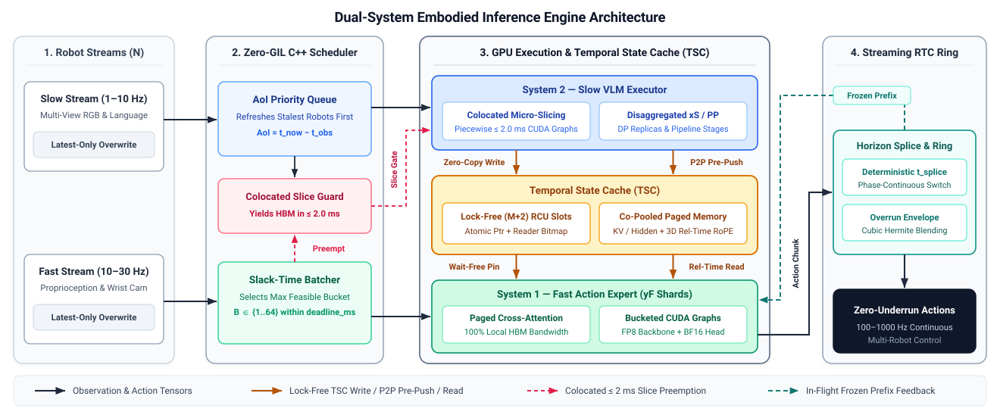

<h1 align="center">Tempo</h1>

<h3 align="center">
Fast serving engine for System 1 + System 2 robot policies
</h3>

<p align="center">
| <a href="#install"><b>Install</b></a> | <a href="#quick-start"><b>Quick Start</b></a> | <a href="#models"><b>Models</b></a> | <a href="#benchmarks"><b>Benchmarks</b></a> | <a href="./examples"><b>Examples</b></a> | <a href="./LICENSE"><b>License</b></a> |
</p>

---

**Tempo** serves `System 1 + System 2` robot policies ($\pi_{0.5}$, GR00T-N1.5, SmolVLA, and custom PyTorch `nn.Module` policies) across single-GPU, multi-GPU, and edge-cloud setups—depending only on `torch`, `safetensors`, and `tokenizers` (no `transformers` or `diffusers`).

<p align="center">
  
</p>

### Key Features

- **Lock-free paged KV and latent cache** shared between asynchronous Slow (System 2) and Fast (System 1) streams
- **Paged Split-K cross-attention** with optional 3D relative-time RoPE for asynchronous sensor timestamps
- **C++ scheduler** with deadline batching and latest-frame sensor coalescing
- **Piecewise CUDA Graph slicing** (`<= 2 ms`) so Slow VLM prefill does not stall Fast action generation on a single GPU
- **Automatic `torch.compile`, bucketed CUDA Graphs, and `FP8`** on standard PyTorch `nn.Module` policies
- **Real-Time Chunking (RTC)** ring buffer with frozen-prefix splicing and smooth overrun blending

## Install

Requires Linux (`x86_64`), Python `>= 3.10`, PyTorch `>= 2.5` with CUDA, CUDA Toolkit `>= 12.0`, and an NVIDIA GPU with `SM80+` (`BF16` on Ampere+; `FP8` on Ada/Hopper/Blackwell `SM89+`).

```bash
git clone https://github.com/darthjaja6/tempo.git
cd tempo
pip install -e . --no-build-isolation
```

<details>
<summary><b>Container &amp; Build Notes</b></summary>

- **Ubuntu 24.04 / PEP 668 containers**: `python3 -m venv --system-site-packages .venv && source .venv/bin/activate` before installing.
- **Headless Docker builds (no GPU attached)**: Export `TORCH_CUDA_ARCH_LIST="8.0;8.9;9.0;12.0"` before `pip install`.
- **Incremental C++/CUDA rebuilds**: Run `python build_ext.py`.

</details>

## Quick Start

### 1. Serve a Pretrained Checkpoint

`push_*` and `sample_actions` are non-blocking (`fast_age_ms < 0` until the first Slow + Fast pass commits):

```python
import time
import torch
from tempo import Engine

with Engine(
    "lerobot/smolvla_base",       # or "lerobot/pi05_base", "nvidia/GR00T-N1.5-3B", or local path
    num_streams=4,
    slow_devices=[0],             # [0] colocated, [0] + fast_devices=[1,2,3] disaggregated, or [[0,1]] PP
    fast_devices=[0],
    prompt="pick up the cup",     # pass fast_precision="fp8" on SM89+ GPUs
) as engine:
    engine.push_slow_batch(torch.randint(0, 256, (4, *engine.slow_obs_shape), dtype=torch.uint8))
    total_underruns = 0
    for step in range(150):       # 500 Hz control loop (2 ms tick)
        if step % 25 == 0:        # 20 Hz Fast input update
            engine.push_fast_batch(torch.randn(4, *engine.fast_obs_shape, dtype=torch.bfloat16))
        actions, fast_age_ms, slow_age_ms, tick_underruns = engine.sample_actions(cpu=True)
        total_underruns += tick_underruns
        time.sleep(0.002)
```

### 2. Custom `SlowBackbone` and `FastHead`

Subclass `SlowBackbone` and `FastHead` (or pair a built-in backbone with `DirectActionHead`) and pass them to `Engine(slow=..., fast=...)`:

```python
from tempo import Engine, FastHead, SlowBackbone, TemporalChannel

class MySlowBackbone(SlowBackbone):
    def __init__(self, encoder):
        super().__init__()
        self.encoder = encoder
        self.channel = TemporalChannel(hidden_dim=512, seq_len=64, mode="hidden")
        self.obs_shape = (3, 224, 224)

    def forward(self, obs, ctx):
        ctx.write_hidden_state(self.encoder(obs))  # or ctx.write_layer_kv(layer_idx, k, v)

class MyFastHead(FastHead):
    action_dim = 7
    chunk_size = 50
    obs_shape = (14,)

    def __init__(self, policy_net):
        super().__init__()
        self.policy_net = policy_net

    def forward(self, fast_obs, state, frozen_prefix):
        hidden, delta_t_sec = state.read_hidden()  # or state.cross_attend(q, layer_idx=i)
        chunk = self.policy_net(fast_obs, hidden, delta_t_sec)
        P = frozen_prefix.size(1)
        chunk[:, :P] = state.splice_prefix(chunk[:, :P], frozen_prefix)
        return chunk  # [B, chunk_size, action_dim]

with Engine(slow=MySlowBackbone(enc), fast=MyFastHead(net), num_streams=4) as engine:
    ...
```

To enable `Engine("org/my-checkpoint")` auto-loading from `config.json`, register a builder with `@ModelRegistry.register("my_policy")`.

### 3. Runnable Examples

```bash
python examples/quickstart.py --model lerobot/smolvla_base
python examples/multi_gpu_serving.py --model nvidia/GR00T-N1.5-3B --topology auto
```

See [examples/quickstart.py](./examples/quickstart.py) and [examples/multi_gpu_serving.py](./examples/multi_gpu_serving.py) for `@engine.stage`, multi-GPU placements, and `RemoteSlowServer` / `RemoteSlowClient`.

## Models

| Checkpoint | System 2 (`SlowBackbone`) | System 1 (`FastHead`) | `fast_obs` &amp; Robot State | Active / Total Params |
| :--- | :--- | :--- | :--- | :---: |
| `lerobot/pi05_base` | PaliGemma-2B (`18L`) | Gemma Expert (`18L`, 10-step Flow) | Flow noise `(chunk_size, 32)`; shared state via `set_prompt(prompt, state=...)` | 2.83B / 3.3B |
| `nvidia/GR00T-N1.5-3B` | Eagle2-VLM (`SigLIP + Qwen3-1.7B`) | Cross-Attn DiT (`16L`, 4-step Flow) | Per-stream robot state `(state_dim,)` (flow noise internal) | 2.09B / 3.0B |
| `lerobot/smolvla_base` | SmolVLM2 (`SigLIP + Llama-16L`) | SmolLM2 Expert (`16L`, 10-step Flow) | Flow noise `(chunk_size, 32)`; shared state via `set_state(...)` | 0.36B / 450M |

`slow_obs` has shape `(num_cameras, 3, H, W)` RGB (`uint8 [0, 255]` or float `[0, 1]`), and states/actions use each checkpoint's normalized space. Fine-tuned checkpoints (such as `lerobot/pi05_libero_finetuned_v044` and `lerobot/smolvla_libero`) load directly without `lerobot` or `transformers`.

## Benchmarks

Each stream drives `2 Hz` Slow camera updates, `20 Hz` Fast chunk requests (`FP8` Fast heads on `SM89+`), and `500 Hz` action polling against a `BF16` multi-stream PyTorch `SDPA` + per-stream `RWLock` baseline (`benchmarks/baselines.py`). **Max Streams at SLO** is the highest stream count meeting `Chunk P99 <= deadline`, `0` underruns, and `Slow staleness P99 <= 950 ms` (the PyTorch baseline misses the latency/underrun SLO at `1` stream). `FP8` Fast heads retain `>0.999` cosine similarity against `BF16` on GR00T-N1.5 and $\pi_{0.5}$, and `>0.993` on SmolVLA.

### 1. Throughput &amp; Latency Across GPUs

`Colocated` runs Slow and Fast on each GPU; `1S : 1F` and `1S : 3F` dedicate 1 GPU to Slow VLM and 1 or 3 GPUs to Fast action heads. `Chunk P99` and `VRAM` are reported at `Max Streams at SLO`.

| Model (Deadline) | Hardware &amp; Placement | Max Streams at SLO | Chunk `P99` (Tempo vs. PyTorch) | Zero-Underrun Capacity | Peak GPU / Total VRAM |
| :--- | :--- | :---: | :---: | :---: | :---: |
| `GR00T-N1.5-3B` (25 ms) | `4x H100 SXM` (`1S : 3F`) | **12** | **9.56 ms** vs. 393.8 ms (41.2x) | 48 streams | 2.67 / 6.95 GB |
| `GR00T-N1.5-3B` (25 ms) | `2x H100 SXM` (`1S : 1F`) | **8** | **10.38 ms** vs. 125.6 ms (12.1x) | 32 streams | 3.23 / 4.73 GB |
| `GR00T-N1.5-3B` (25 ms) | `1x H100 SXM` (`Colocated`) | **8** | **22.12 ms** vs. 150.6 ms (6.8x) | 32 streams | 3.98 / 3.98 GB |
| `pi0.5` (30 ms) | `2x H100 SXM` (`1S : 1F`) | **1** | **20.76 ms** vs. 423.6 ms (20.4x) | 2 streams | 5.85 / 7.18 GB |
| `pi0.5` (30 ms) | `1x H100 SXM` (`Colocated`) | **1** | **28.31 ms** vs. 457.4 ms (16.2x) | 2 streams | 6.15 / 6.15 GB |
| `pi0.5` (30 ms) | `2x RTX PRO 6000` (`1S : 1F`) | **1** | **23.71 ms** vs. 381.9 ms (16.1x) | 2 streams | 5.35 / 6.63 GB |
| `pi0.5` (30 ms) | `1x RTX PRO 6000` (`Colocated`) | **1** | **28.82 ms** vs. 394.9 ms (13.7x) | 2 streams | 6.10 / 6.10 GB |
| `pi0.5` (35 ms) | `1x RTX 4090` (`Colocated`) | **1** | **23.90 ms** vs. 271.6 ms (11.4x) | 2 streams | 5.49 / 5.49 GB |
| `SmolVLA` (25 ms) | `2x RTX PRO 6000` (`1S : 1F`) | **12** | **22.98 ms** vs. 292.1 ms (12.7x) | 16 streams | 1.05 / 1.53 GB |
| `SmolVLA` (25 ms) | `1x RTX PRO 6000` (`Colocated`) | **12** | **24.11 ms** vs. 360.5 ms (15.0x) | 16 streams | 1.19 / 1.19 GB |
| `SmolVLA` (25 ms) | `1x RTX 4090` (`Colocated`) | **8** | **24.36 ms** vs. 136.1 ms (5.6x) | 12 streams | 0.89 / 0.89 GB |

### 2. 4-GPU Placement Trade-Offs (`lerobot/pi05_base`, 4 Concurrent Streams)

All Tempo placements below run with `0` underruns. Disaggregating Slow/Fast GPUs (`1S : 3F`) or 2-stage Slow pipeline parallelism (`slow=[[0,1]], fast=[2,3]`) cuts total VRAM by `45%–59%` on both NVLink and PCIe hosts:

| Placement (`N = 4`) | `4x H100 SXM` Chunk `P50 / P99` | `4x H100` Peak / Total VRAM | `4x RTX PRO 6000` Chunk `P50 / P99` | `4x RTX PRO 6000` Peak / Total VRAM |
| :--- | :---: | :---: | :---: | :---: |
| `4x Colocated` (`slow=[0..3], fast=[0..3]`) | **20.55 / 26.82 ms** | 5.89 / 23.55 GB | **22.12 / 28.76 ms** | 5.84 / 23.35 GB |
| `2S : 2F` (`slow=[0,1], fast=[2,3]`) | 20.38 / 36.88 ms | 5.85 / 15.69 GB | 23.48 / 42.45 ms | 5.35 / 13.68 GB |
| `1S : 3F` (`slow=[0], fast=[1,2,3]`) | 20.57 / 36.83 ms | 6.42 / **12.68 GB (-46%)** | 22.18 / 39.74 ms | 5.72 / **9.76 GB (-58%)** |
| `2-Stage PP + 2F` (`slow=[[0,1]], fast=[2,3]`) | 20.40 / 36.40 ms | **4.33** / 12.95 GB (-45%) | 22.18 / 39.68 ms | **3.53** / **9.50 GB (-59%)** |

### 3. Closed-Loop Simulation Sanity Check (LIBERO MuJoCo, `1x RTX 4090`)

End-to-end closed-loop rollouts through `tempo.Engine` (`benchmarks/libero_e2e_eval.json`, 30 Hz control loop, `0` underruns across all episodes, `~200 µs` `sample_actions` P50):

| Suite | Task | `pi05_libero_finetuned_v044` (3.3B) | `smolvla_libero` (450M) |
| :--- | :--- | :---: | :---: |
| `libero_spatial` | Pick up the black bowl between the plate and ramekin and place it on the plate | Pass (83 steps) | Fail (220 steps) |
| `libero_object` | Pick up the alphabet soup and place it in the basket | Pass (137 steps) | Pass (143 steps) |
| `libero_goal` | Open the middle drawer of the cabinet | Pass (129 steps) | Pass (200 steps) |

### Reproduce Throughput &amp; Latency Benchmarks

```bash
python -m benchmarks.run_suite --model lerobot/smolvla_base --mode colocated --deadline-ms 25 --streams 1,4,8,12,16
python -m benchmarks.run_suite --model nvidia/GR00T-N1.5-3B --mode both --deadline-ms 25 --streams 1,4,8,16,24,32
python -m benchmarks.run_suite --model nvidia/GR00T-N1.5-3B --mode custom --slow-devices 0 --fast-devices 1,2,3 --deadline-ms 25 --streams 4,12,24,32,42,48
python -m benchmarks.run_suite --model lerobot/pi05_base --mode four_gpu_matrix --deadline-ms 30 --streams 4,8,12,16,24,32
```

## License

Released under the [Apache-2.0 License](./LICENSE).
