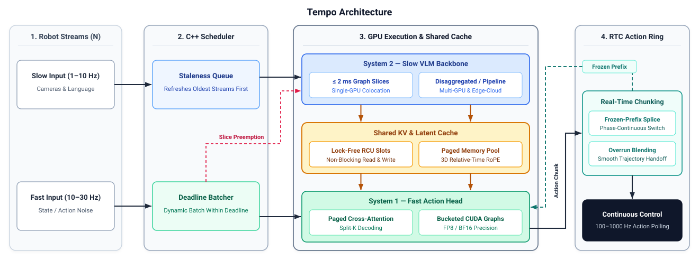

# Tempo Architecture

Modern embodied policies increasingly pair a low-frequency **System 2 (`SlowBackbone`, `1–10 Hz` VLM)** for scene and language understanding with a high-frequency **System 1 (`FastHead`, `10–30 Hz` flow-matching or diffusion action expert)** driving `100–1000 Hz` continuous control. Serving these dual-rate policies on standard LLM engines or Python async queues hits three bottlenecks:

1. **Cross-rate lock contention and torn reads**: Multi-step Fast denoising repeatedly reads Slow states; even a `2%` per-stream lock collision stalls `1 - 0.98^32 ≈ 48%` of `Batch = 32` Fast launches, while unguarded updates cause torn reads.
2. **Shared HBM bandwidth interference**: Small-batch action denoising is memory-bandwidth bound; a concurrent VLM prefill saturates HBM controllers and flushes L2 cache, spiking Fast tail latency by `10x–100x`.
3. **Chunk boundary discontinuities**: Continuous physical control cannot pause for late chunks; unaligned handoffs cause trajectory jumps or action queue underflow.

Tempo resolves all three inside a C++/CUDA runtime beneath standard PyTorch `nn.Module` policies.

  

---

## 1. Lock-Free Paged State Cache

Tempo decouples 64-byte cache-line-aligned atomic control headers from a reference-counted GPU page pool shared across Slow and Fast streams:

- **Lock-free `(M + 2)`-slot RCU protocol**: For `M` downstream Fast consumer stages (`M = 1` in standard System 1 + System 2 policies, i.e., `3` slots per robot stream), at most `M` slots are pinned by in-flight Fast batches and `1` slot holds the latest committed Slow state—guaranteeing the Slow writer always has a free slot with **zero locks and zero torn reads** across arbitrary batch sizes.
- **Unified KV and latent modes**: Pages store either layer-wise KV caches (`mode="kv"`, read via a paged Split-K cross-attention kernel) or dense latent tensors (`mode="hidden"`, returned alongside per-stream physical staleness `Δt = t_now - t_obs`).
- **24/7 relative-time 3D RoPE**: Bounded spatial `(h, w)` rotary embeddings are applied before caching, while relative temporal rotation `Δt = t_now - t_obs` is applied on-the-fly in SRAM from frame timestamps during attention—preventing position-ID overflow in continuous multi-day operation.

## 2. Sub-2ms Micro-Slicing & Deadline Batching

A dedicated GIL-free C++ worker thread per GPU owns kernel submission and real-time scheduling:

- **Latest-frame coalescing & deadline batching**: Ingress mailboxes overwrite unconsumed stale camera frames in `O(1)`. Fast requests are dynamically grouped by remaining slack time into bucketed full-model `CUDA Graph`s (`B ∈ {1, 2, 4, 8, 16, 32, 64}`), optionally pairing `FP8` linear weights with `BF16` modulation and output heads; Slow queues refresh the stalest streams first when saturated.
- **Sub-`2 ms` piecewise VLM slicing (`Colocated`)**: On a shared GPU, Tempo's startup profiler automatically splits the PyTorch `SlowBackbone` into piecewise `CUDA Graph` slices bounded to **`<= 2.0 ms`** each. Whenever a Fast batch becomes ready, the C++ dispatcher halts after the current slice, handing **100% of SMs and HBM bandwidth** to Fast denoising within `2 ms` and eliminating CUDA driver lock priority inversion.

## 3. Real-Time Chunking (RTC) & Horizon Ring

Each Fast forward emits an overlapping action chunk of horizon `H > T_fast + Δ_deadline` (replan period plus latency deadline) into a double-buffered C++/CUDA physical-time trajectory ring decoupled from Slow/Fast execution:

- **Prefix-conditioned policies**: When a model supports prefix conditioning, the ring extracts the in-flight frozen prefix up to the deterministic splice timestamp `t_obs + deadline_ms` so new trajectories condition smoothly on already-committed actions.
- **Off-the-shelf checkpoints**: For standard flow-matching or diffusion policies trained without prefix conditioning, Tempo preserves unmodified model rollouts and applies cubic Hermite blending across the physical overlap window—automatically continuing along the prior chunk's remaining horizon if a transient spike delays the next chunk.

## 4. Slow/Fast Disaggregation & Edge-Cloud Split Serving

Tempo exposes orthogonal multi-GPU and distributed placement without changing policy code (benchmark numbers in [benchmarks/README.md](../benchmarks/README.md)):

- **Colocated (`slow_devices=[0..k], fast_devices=[0..k]`)**: Each GPU runs both Slow slices and Fast graphs locally.
- **Asymmetric Slow/Fast Disaggregation (`slow_devices=[0], fast_devices=[1, 2, 3]`)**: Dedicated Slow GPUs pre-push computed state pages over NVLink/PCIe directly into target Fast GPUs' unpublished `(M + 2)` write slots and atomically flip the ready pointer once all layers arrive—giving Fast heads `100%` local memory reads with zero VLM interference and cutting 3B+ VLA cluster VRAM by **46–58%**.
- **Slow Pipeline Parallelism (`slow_devices=[[0, 1]], fast_devices=[2, 3]`)**: Large VLMs split across stages overlap inter-GPU page pre-push with downstream stage compute, reducing both per-GPU peak VRAM and total cluster VRAM (**45–59%**).
- **Edge-Cloud Split Serving (`RemoteSlowServer` / `RemoteSlowClient`)**: On-robot Fast loops run purely locally while receiving asynchronous latent updates over TCP with echo-timestamp staleness tracking.
